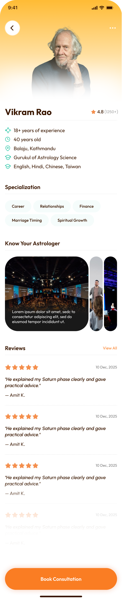

# Life Rishi Promo — Storylines

## The One Thing
- **What it is**: Life Rishi brings Vedic astrological chart calculation, 24/7 conversational AI guidance (AI Rishi), and direct verified Gurukul astrologer consultations into one sleek mobile app.
- **The one thing to remember**: "Ancient Vedic wisdom in your pocket—instant cosmic clarity when life gets uncertain."
- **Spine**: A user navigating daily life decisions, receiving personalized Vedic chart insights ("Foundation Building: Prioritize structure over speed"), consulting the AI Rishi companion, and accessing certified astrologers in one seamless flow.

---

## Storyline 1 (Recommended): "The Cosmic Guide in Your Pocket"
*Why recommended: It flows naturally through the 3 real screens provided—anchoring in daily Vedic alignment, diving into conversational AI guidance, and concluding with human master consultation.*

- **Device & Form**: *A moment in someone's day* paired with an *Object-to-object chain*.
- **Summary**: A professional waking up uncertain about a major career move opens Life Rishi to find clarity in seconds—first through daily Vedic energy alignment, then asking the glowing AI Rishi for instant direction, before seamlessly escalating to a deep 1-on-1 consultation with a Gurukul-trained master. The viewer feels a sudden transition from morning anxiety and uncertainty to grounded, calm cosmic certainty.
- **First Two Seconds**: Frame 0 opens tight on a restless morning headline cutting sharply to the glowing Scorpio emblem and the bold daily insight: *"Foundation Building: Prioritize structure over speed."* A finger taps "Explore AI Rishi" as the orange cosmic orb pulses awake.
- **Beats**:
  `Hook (Daily energy & planetary sync) → Tension (Career & life timing uncertainty) → Reveal (AI Rishi companion) → Proof (Interactive chart insights & actionable advice) → Payoff (One-tap booking with 18+ yr master Vikram Rao) → Claim ("Ancient Vedic Wisdom. Everyday Clarity.") → End Card (Life Rishi emblem lockup & download CTA)`
- **Look**: Warm dawn cream ground (`#FFF8F3`) shifting into luminous saffron/amber gradients (`#FF7A1A`, `#FF9E44`), clean modern sans-serif typography with warm serif accents, soft frosted cards.
- **Sound**: Subtle ambient morning chime into an evolving warm tanpura/ambient synth pad, gentle haptic clicks, rhythmic cosmic pulse when AI Rishi speaks, resolving to a resonant brass singing bowl tone.

---

## Storyline 2: "Awakening Rishi" (The Celestial AI Companion)
- **Device & Form**: *The character does the work* paired with *One continuous take & punch-ins*.
- **Summary**: Hosted entirely by the animated AI Rishi cosmic entity—a radiant orange celestial orb with blinking eyes and orbiting planetary rings that navigates through the user's life questions in real-time. The viewer feels connected to a living, empathetic digital mystic that demystifies astrology and makes complex Vedic calculations feel effortless.
- **First Two Seconds**: Frame 0 is a dark celestial void that ignites into radiant amber light as the AI Rishi orb blinks awake, smiles, and floating orbital particles ripple outward: *"Hi, Sam! Ask me anything."*
- **Beats**:
  `Hook (AI Rishi orb wakes up with kinetic planetary rings) → Question & Input (Prompt chip clicked: "What is my sun sign?") → Proof (Orb spins, materializing birth chart: Sun in Capricorn, Moon in Taurus, Rising in Scorpio) → Tension & Remedy (Karmic timing challenge → actionable guidance) → Escalation (Rishi offers human master backup: Vikram Rao profile glides into view) → Claim ("Vedic Intelligence for the Modern Mind") → End Card (Glowing Rishi mascot transforms into the app icon lockup)`
- **Look**: Deep celestial twilight transitioning into radiant saffron-gold glow, glowing SVG particle rings, high-contrast card reveals.
- **Sound**: Shimmering ambient stardust chime, playful synthetic vocal chirp/pulse for the orb's blink, rhythmic low tabla beat, soft whoosh transitions.

---

## Storyline 3 (The Bold One): "Two Worlds, One Truth" (Ancient Heritage Meets AI)
- **Device & Form**: *Match cuts & split-to-one* paired with *Life before and after*.
- **Summary**: Juxtaposes the intimidating complexity of traditional thousand-year-old Vedic scrolls and manual Kundali charts against the instant, elegant simplicity of Life Rishi on mobile. The viewer experiences the reverence of authentic Gurukul heritage paired seamlessly with the speed of artificial intelligence.
- **First Two Seconds**: Frame 0 cuts on a split second between an ancient Sanskrit Kundali diagram and an iPhone screen rendering the exact same planetary positions in sleek modern typography.
- **Beats**:
  `Hook (Ancient Kundali wheel match-cuts directly into the modern interactive chart) → Tension (Traditional astrology felt inaccessible, cryptic, or slow) → Reveal ("Ancient Vedic Science. Digitized.") → Proof (Kundali calculations in milliseconds → 24/7 AI conversational guidance → Instant verified Gurukul master booking) → Payoff (Daily alignment verified: confidence unlocked) → Claim ("5,000 years of Vedic wisdom. Right on time.") → End Card (Emblem stamp, Life Rishi wordmark, download CTA)`
- **Look**: Rich textural parchment gold and deep terracotta contrasting with crisp minimalist mobile UI surfaces and vibrant energetic orange buttons.
- **Sound**: Deep temple bell strike transforming into a fast, modern chill beat with subtle bansuri flute accents and crisp haptic UI clicks.
